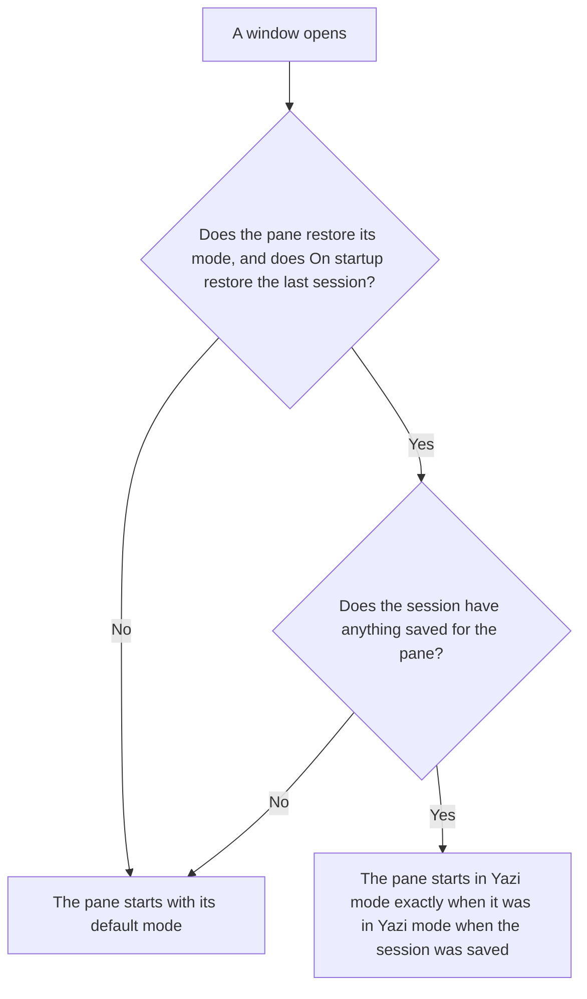

# Yazi mode

Yazi mode is an optional, per-pane way to browse folders in columns, inspired
by [Yazi](https://yazi-rs.github.io/docs/quick-start/), a terminal file
manager. This guide covers using it (M25) and configuring it under
**Preferences › Yazi Mode** (M26).

> [!NOTE]
> Yazi mode is not an embedded Yazi process. Plasma Opus doesn't need Yazi
> installed, and it doesn't read Yazi's configuration, key maps, themes or
> plugins. It is a native Qt and KDE layout built on Plasma Opus's own folder
> view, file models, actions and KIO jobs.

## Contents

- [Overview](#overview)
- [Quick start](#quick-start)
- [The columns](#the-columns)
- [Keyboard](#keyboard)
- [Selection and file actions](#selection-and-file-actions)
- [Filtering, search, sorting, tabs and history](#filtering-search-sorting-tabs-and-history)
- [Previews and file information](#previews-and-file-information)
- [Locations and limits](#locations-and-limits)
- [Persistence and workspaces](#persistence-and-workspaces)
- [Settings](#settings)
- [Configuration reference](#configuration-reference)
- [Accessibility](#accessibility)
- [Known limitations](#known-limitations)

## Overview

Yazi mode is per pane and off by default. A pane in Yazi mode shows up to
three columns side by side:

| Column                       | What it shows                                                                                                        |
| ---------------------------- | -------------------------------------------------------------------------------------------------------------------- |
| **Parent column**            | A read-only listing of the parent folder, with the current folder highlighted                                        |
| **Current column**           | The pane's usual folder view, with the same selection, filter, sorting, actions, context menu and keyboard behaviour |
| **Preview column**, optional | The focused item of the current column: its preview, a folder's contents, or its file information                    |

The other pane, the tab bar, the location bar, the filter bar and the status
bar are unchanged. The columns fit the pane's own width, so the other pane is
never resized, hidden or replaced.

Everything in the mode goes through Plasma Opus's existing tools: file actions
use the window's own actions, filtering uses the pane's filter bar, searching
uses the search panel, and previews, file information and transfer progress
come from the preview panel, the **Information** panel and the transfer queue.
The results are the same as outside the mode.

### What stays the same

Entering or leaving Yazi mode moves the pane's existing folder view into or
out of the columns; it doesn't recreate the view or reload the folder. Leaving
the mode restores exactly what was there:

- both panes, and all of each pane's tabs, with their pins, locks and names;
- each tab's location and history;
- the selection, current item and scroll position;
- the name filter and its scope;
- sorting;
- the view mode (details, icons, compact or cards) and view settings such as
  icon size, previews and hidden files.

Yazi mode doesn't change the view mode, and nothing it does is saved as the
pane's view mode.

## Quick start

1. **Turn it on.** Choose **View › Yazi Mode**, or click the **Yazi mode**
   button at the right of the window's status bar. The active pane shows its
   parent, current and preview columns, and a **Yazi** label appears below
   them.
2. **Move around.** <kbd>Up</kbd> and <kbd>Down</kbd> move the focus,
   <kbd>Left</kbd> opens the parent folder, and <kbd>Right</kbd> or
   <kbd>Return</kbd> opens the focused folder or file.
   <kbd>Ctrl</kbd>+<kbd>Space</kbd> selects or deselects the focused item. The
   preview follows the focus, and the window's usual shortcuts keep working.
3. **Optionally, use the Yazi-style keys.** Check **View › Vim-Style Keys in
   Yazi Mode** to add letters such as <kbd>h</kbd> <kbd>j</kbd> <kbd>k</kbd>
   <kbd>l</kbd>, sequences such as <kbd>g</kbd> <kbd>g</kbd> and counts such as
   <kbd>5</kbd> <kbd>j</kbd>; see [Keyboard](#keyboard).
4. **Turn it off.** Choose **View › Yazi Mode** again, or press <kbd>q</kbd>
   with the Yazi-style keys. The pane returns exactly as it was.

To have a pane start in Yazi mode whenever a window opens, see
[Activation](#activation).

> [!TIP]
> No Yazi mode action has a default shortcut. Assign one to `toggle_yazi_mode`
> in **Settings › Configure Keyboard Shortcuts…**, or add it to a toolbar.

### Ways to turn it on and off

- **View › Yazi Mode** (action `toggle_yazi_mode`) applies to the active pane.
  It is checked when the active pane is in Yazi mode and follows the active
  pane as focus moves between panes.
- The **Yazi mode** button at the right of the window's status bar applies to
  the active pane and is checked when that pane is in Yazi mode.
- **Yazi Mode** at the end of each pane's **View Mode** menu, on the pane
  toolbar, applies to that pane.
- The main toolbar's customizer lists **Yazi Mode** among the available
  actions.
- The pane toolbar has a **Yazi Mode** button that is hidden by default and
  can be shown from the pane toolbar's customizer.
- With the Yazi-style keys, <kbd>q</kbd> leaves Yazi mode.

None of these has a default shortcut, and none is on a toolbar by default, so
existing bindings and toolbars don't change.

### The mode indicator

While the mode is on, a label below the columns marks the pane: **Yazi**, or
**Yazi · Vim** with the Yazi-style keys. Its accessible name is "Yazi mode" or
"Yazi mode with Vim-style keys", so screen readers announce it too. While a key
sequence is being typed, the label shows the keys so far, such as
**Yazi · Vim · g…**; see [Counts and key sequences](#counts-and-key-sequences).

The label is part of the **status row** below the columns, which also shows
location notes, messages, the selection count, the filter, search progress,
transfers and the sort. Each part is described where it is used.

## The columns

### Parent column

The parent column lists the parent folder, read-only, with the current folder
highlighted.

- Clicking a folder, or pressing <kbd>Return</kbd> on it, opens that folder in
  the current tab, like any other navigation.
- Clicking a file opens the folder the parent column lists, with that file
  selected.
- Hidden items, including local folders set to **Hide in parent folder** in
  **Folder Look…**, follow the pane's **Show Hidden Files** setting.
- Items are sorted by name, folders first, whatever the pane's sorting.
- Renaming, dragging and context menus are not available there; use the
  current column for file actions.
- At a root, such as `/` or `sftp://host/`, there is no parent, so the column
  is empty.
- It uses the current column's font, so it follows the pane's list font
  settings. It keeps the current folder highlighted and scrolled into view
  after navigation, when it is shown and after a font change.

The parent folder is listed in the background; see
[Locations and limits](#locations-and-limits).

### Current column

The current column is the pane's own folder view, moved into the columns. It
keeps the pane's view mode, selection, filter, sorting, actions, context menu,
keyboard behaviour and thumbnails. Its original accessible names are restored
when the mode is turned off.

### Preview column

The preview column shows the **focused item** of the current column: its
current index, which moves with the keyboard even when the selection doesn't.
It shows the item's preview, a focused folder's contents, or the item's file
information; see [Previews and file information](#previews-and-file-information).

### Showing and hiding columns

The current column is always shown. The parent and preview columns can be
shown or hidden per pane:

| Column  | Menu item (action)                                          | Yazi-style key            | Default                                                    |
| ------- | ----------------------------------------------------------- | ------------------------- | ---------------------------------------------------------- |
| Parent  | **View › Yazi Parent Column** (`toggle_yazi_parent_column`) |                           | **Show the parent column** (`YaziParentColumnVisible`), on |
| Preview | **View › Yazi Preview** (`toggle_yazi_preview`)             | <kbd>z</kbd> <kbd>p</kbd> | **Show the preview column** (`YaziPreviewVisible`), on     |

- The menu items apply to the active pane, are checked when that pane shows the
  column, and are enabled only while the active pane is in Yazi mode. They have
  no default shortcuts.
- The defaults are set in
  **Preferences › Yazi Mode › Columns**; see [Columns](#columns). Panes whose
  column was never toggled follow the default, including when it changes; a
  pane toggled from the menu keeps its own choice.
- Without the parent column, the current and preview columns share the pane in
  their own ratio, 3 : 2 by default, and the preview needs room only for itself
  and the current column before it is hidden.
- A pane too narrow for a column still hides it, whatever the choice; see
  [Narrow panes](#narrow-panes).
- If a column holding the keyboard focus is hidden, the focus moves to the
  current column.

### Column widths

The parent, current and preview columns share the pane's width in the ratio
1 : 3 : 2 by default, with minimums of 100, 220 and 160 pixels.

- Drag the splitter handles between the columns to change their widths. The
  resulting proportions are kept as the pane is resized and reused when hidden
  columns return.
- Dragged widths are saved for the pane, and, half a second after dragging
  stops, become the default for other panes. Dragging in one pane doesn't
  resize other open panes that follow the default; they use it the next time
  the configuration is applied, and new windows start with it.
- **Preferences › Yazi Mode › Columns › Column Widths** shows and edits the
  default widths; see [Columns](#columns).

### Narrow panes

The columns adapt to the pane's own width, never the window's, so the other
pane is never resized, hidden or replaced. This isn't configurable.

- Below 480 pixels, plus the splitter handles, the preview column is hidden
  first.
- Below 320 pixels, plus a handle, the parent column is hidden too, and the
  current column, at least 220 pixels wide, takes the whole pane.
- When the pane widens again, the hidden columns come back.

When columns are hidden in a narrow pane, the current column keeps all of its
keyboard navigation.

## Keyboard

Yazi mode can be browsed from the keyboard alone, with one of two key presets.
The preset applies to both panes whenever they are in Yazi mode.

| Preset            | **Preferences › Yazi Mode › Keyboard** shows                   | **View › Vim-Style Keys in Yazi Mode** | Indicator      | `YaziKeyPreset` |
| ----------------- | -------------------------------------------------------------- | -------------------------------------- | -------------- | --------------- |
| Standard, default | **Standard keys**                                              | Unchecked                              | **Yazi**       | `Standard`      |
| Yazi-style        | **Yazi-style keys (Vim-style movement and multi-key actions)** | Checked                                | **Yazi · Vim** | `Vim`           |

- The **standard keys** use the arrow keys and the usual navigation keys.
- The **Yazi-style keys** add Vim-like letters, multi-key sequences such as
  <kbd>g</kbd> <kbd>g</kbd> and counts such as <kbd>5</kbd> <kbd>j</kbd> to the
  standard keys.

The second preset has two names in the interface. The **Keyboard** tab calls
it **Yazi-style keys**; the View menu's toggle **Vim-Style Keys in Yazi
Mode**, the **Yazi · Vim** indicator and the `Vim` configuration value name it
after the Vim-style movement it adds. They are the same preset, and this guide
calls it the Yazi-style keys.

To switch presets, toggle **View › Vim-Style Keys in Yazi Mode** (action
`toggle_yazi_vim_keys`, no default shortcut), which switches at once and saves
the choice, or choose one on the **Keyboard** tab, which shows its keys and
conflicts first; see [Keyboard settings](#keyboard-1). The keys of each preset
are fixed and can't be changed one by one.

### Standard keys

The Standard preset binds these keys. The Yazi-style keys include them too.

| Keys                                                  | Command                             |
| ----------------------------------------------------- | ----------------------------------- |
| <kbd>Up</kbd>                                         | Move up                             |
| <kbd>Down</kbd>                                       | Move down                           |
| <kbd>Home</kbd>                                       | Move to the first item              |
| <kbd>End</kbd>                                        | Move to the last item               |
| <kbd>Page Up</kbd>                                    | Move a page up                      |
| <kbd>Page Down</kbd>                                  | Move a page down                    |
| <kbd>Left</kbd>                                       | Open the parent folder              |
| <kbd>Right</kbd>, <kbd>Return</kbd>, <kbd>Enter</kbd> | Open the focused folder or file     |
| <kbd>Ctrl</kbd>+<kbd>Space</kbd>                      | Select or deselect the focused item |

In right-to-left layouts, <kbd>Left</kbd> and <kbd>Right</kbd> swap, as they
do in the folder view.

The standard keys add no letters for file actions, filtering, search, sorting
or tabs, and shadow none of the default shortcuts. The window's own shortcuts,
such as <kbd>Ctrl</kbd>+<kbd>C</kbd>, <kbd>Ctrl</kbd>+<kbd>X</kbd>,
<kbd>Ctrl</kbd>+<kbd>V</kbd>, <kbd>F2</kbd>, <kbd>Delete</kbd>, <kbd>F5</kbd>,
<kbd>F6</kbd>, <kbd>Ctrl</kbd>+<kbd>Z</kbd>, <kbd>Ctrl</kbd>+<kbd>A</kbd>,
<kbd>Ctrl</kbd>+<kbd>F</kbd> (**Filter…**) and
<kbd>Ctrl</kbd>+<kbd>Alt</kbd>+<kbd>F</kbd> (**Search Current Folder…**), are
not bound by the preset and keep working in the columns, as do type-ahead
filtering and the tab shortcuts. <kbd>Space</kbd> alone stays **Open
Gallery**.

### Yazi-style keys

All the standard keys, plus the keys below. The command names are those shown
in the **Keyboard** tab's **Preset Keys** list.

**Movement and navigation**

| Keys                         | Command                         |
| ---------------------------- | ------------------------------- |
| <kbd>k</kbd>                 | Move up                         |
| <kbd>j</kbd>                 | Move down                       |
| <kbd>g</kbd> <kbd>g</kbd>    | Move to the first item          |
| <kbd>G</kbd>                 | Move to the last item           |
| <kbd>Ctrl</kbd>+<kbd>U</kbd> | Move half a page up             |
| <kbd>Ctrl</kbd>+<kbd>D</kbd> | Move half a page down           |
| <kbd>h</kbd>                 | Open the parent folder          |
| <kbd>l</kbd>                 | Open the focused folder or file |
| <kbd>H</kbd>                 | Go back                         |
| <kbd>L</kbd>                 | Go forward                      |
| <kbd>g</kbd> <kbd>h</kbd>    | Open the home folder            |

**Columns and mode**

| Keys                      | Command                                                |
| ------------------------- | ------------------------------------------------------ |
| <kbd>g</kbd> <kbd>p</kbd> | Focus the parent column                                |
| <kbd>g</kbd> <kbd>c</kbd> | Focus the current column                               |
| <kbd>g</kbd> <kbd>v</kbd> | Focus the preview column                               |
| <kbd>z</kbd> <kbd>p</kbd> | Show or hide the preview column                        |
| <kbd>i</kbd>              | Switch the preview column to file information, or back |
| <kbd>q</kbd>              | Leave Yazi mode                                        |

**Selection**

| Keys                                       | Command                                             |
| ------------------------------------------ | --------------------------------------------------- |
| <kbd>Space</kbd>                           | Select or deselect the focused item, then move down |
| <kbd>v</kbd>                               | Start or end range selection                        |
| <kbd>V</kbd>, <kbd>Ctrl</kbd>+<kbd>A</kbd> | Select all                                          |

**File actions**

| Keys                      | Command                                 |
| ------------------------- | --------------------------------------- |
| <kbd>y</kbd> <kbd>y</kbd> | Copy the items to the clipboard         |
| <kbd>x</kbd>              | Cut the items to the clipboard          |
| <kbd>p</kbd>              | Paste into the current folder           |
| <kbd>r</kbd>              | Rename the items                        |
| <kbd>d</kbd> <kbd>d</kbd> | Move the items to the Trash             |
| <kbd>a</kbd>              | Create a new folder or file             |
| <kbd>o</kbd>              | Open the items with another application |
| <kbd>c</kbd>              | Copy the items to the other pane        |
| <kbd>m</kbd>              | Move the items to the other pane        |
| <kbd>u</kbd>              | Undo the last file operation            |
| <kbd>.</kbd>              | Show or hide hidden files               |

**Filtering, search and sorting**

| Keys                      | Command                                    |
| ------------------------- | ------------------------------------------ |
| <kbd>/</kbd>              | Open the pane's filter bar                 |
| <kbd>\\</kbd>             | Clear the pane's filter                    |
| <kbd>s</kbd>              | Search file names in the current folder    |
| <kbd>S</kbd>              | Search file contents in the current folder |
| <kbd>,</kbd> <kbd>n</kbd> | Sort by name                               |
| <kbd>,</kbd> <kbd>s</kbd> | Sort by size                               |
| <kbd>,</kbd> <kbd>m</kbd> | Sort by modification date                  |
| <kbd>,</kbd> <kbd>e</kbd> | Sort by type                               |
| <kbd>,</kbd> <kbd>r</kbd> | Reverse the sort order                     |

**Tabs**

| Keys                                    | Command                              |
| --------------------------------------- | ------------------------------------ |
| <kbd>t</kbd>                            | Open the focused folder in a new tab |
| <kbd>[</kbd>, <kbd>g</kbd> <kbd>T</kbd> | Go to the previous tab               |
| <kbd>]</kbd>, <kbd>g</kbd> <kbd>t</kbd> | Go to the next tab                   |
| <kbd>g</kbd> <kbd>w</kbd>               | Close the current tab                |

- <kbd>G</kbd>, <kbd>H</kbd>, <kbd>L</kbd>, <kbd>S</kbd>, <kbd>T</kbd> and
  <kbd>V</kbd> are <kbd>Shift</kbd> with the letter. Punctuation keys match
  whatever <kbd>Shift</kbd> the keyboard layout needs to type them.
- "The items" are the selected items, or the focused item when nothing is
  selected; see [Selection](#selection).
- <kbd>Ctrl</kbd>+<kbd>Space</kbd>, from the standard keys, selects or
  deselects without moving.
- <kbd>Escape</kbd> clears the selection, as it does in the folder view, when
  nothing else is pending.
- <kbd>D</kbd> is deliberately not bound; see [Safety](#safety).

### Counts and key sequences

**Counts.** A number typed first repeats the movement commands and
<kbd>Space</kbd>: <kbd>5</kbd> <kbd>j</kbd> moves five items down,
<kbd>2</kbd> <kbd>Ctrl</kbd>+<kbd>D</kbd> a whole page, and <kbd>3</kbd>
<kbd>Space</kbd> selects or deselects three items. The commands that take a
count are moving up and down, by a page and by half a page, and
<kbd>Space</kbd>; other commands ignore the number. Counts stop at 999.
Digits 1 to 9 start a count, on the main keyboard or the keypad, so type-ahead
can't begin with them in the columns; 0 is only part of a count after another
digit.

**Key sequences.**

- After the first key of a sequence such as <kbd>g</kbd>, the mode waits for
  the next key and the indicator shows the keys so far, such as
  **Yazi · Vim · g…**, with a matching accessible name.
- A pending sequence or count is cancelled after about one second without a
  key, when the focus moves, or with <kbd>Escape</kbd>. <kbd>Escape</kbd> then
  cancels only; it doesn't leave the mode.
- With nothing pending, <kbd>Escape</kbd> cancels a search started with
  <kbd>s</kbd> or <kbd>S</kbd> while one runs; otherwise it is left to the
  columns, so it clears the selection in the current column and returns from
  the preview to the current column.
- A key that doesn't continue the sequence cancels it and then counts on its
  own, so <kbd>g</kbd> followed by <kbd>j</kbd> moves down.
- Modifier keys pressed on their own, such as <kbd>Shift</kbd> before
  <kbd>G</kbd>, don't break a sequence.

### When the keys apply

The keys apply only while the pane is in Yazi mode and the keyboard focus is
in one of its columns: the parent column, the current column's items or the
preview. Elsewhere, and in panes outside Yazi mode, keys behave as they always
do, unless [Vim-style navigation](keyboard.md#vim-style-navigation) is on: it
gives the file views of panes outside Yazi mode Vim-style keys of their own,
from the same commands and key matching. A pane in Yazi mode uses only its
preset, so the Yazi-style keys win there.

- **Typing is never intercepted.** Text fields, such as the filter bar, the
  location bar, search fields and an inline rename editor, spin boxes and
  combo boxes keep every key, and so do the terminal and editor panels.
- **Unbound keys pass through.** Keys the preset doesn't bind are let through
  untouched, so the views' own keys, type-ahead filtering and window shortcuts
  keep working. With the Yazi-style keys, the bound letters are taken in the
  columns, but other letters still start type-ahead.
- **Bound keys win in the columns.** Keys the preset binds take precedence over
  window shortcuts while the focus is in the columns. With the Yazi-style keys,
  <kbd>Ctrl</kbd>+<kbd>D</kbd> moves half a page there rather than adding a
  favourite; **Go › Add to Favorites** still works from the menu and elsewhere
  in the window. Likewise, <kbd>Space</kbd> selects rather than opening the
  gallery in the columns; **View › Open Gallery** and its shortcut still work
  elsewhere. The **Keyboard** tab lists every shortcut a preset shadows; see
  [Keyboard settings](#keyboard-1).
- **Tab is free.** Neither preset uses <kbd>Tab</kbd> or
  <kbd>Shift</kbd>+<kbd>Tab</kbd>, so they keep switching panes and moving the
  keyboard focus; see [Accessibility](#accessibility).

### How the commands behave

- Movement acts on the focused column: the parent column when it has the
  focus, otherwise the current column. It moves the focus and selection
  exactly as the column's own arrow keys would, so in icon and card views
  <kbd>Up</kbd> and <kbd>Down</kbd> move by a row of items.
- Opening the parent folder focuses and selects the folder just left, and the
  parent column highlights the new current folder.
- Opening an item uses the same path as activating it: folders open in the
  pane and files open as they normally would. In the parent column, opening
  the current folder moves the focus to the current column.
- Opening the home folder opens **Go › Home**'s folder.
- Focusing a hidden parent or preview column shows a status message instead.

### Unavailable commands

A key command that can't run says why in the status row for five seconds,
instead of doing nothing. For example:

- moving in an empty column, opening the parent of a root folder or opening
  with nothing focused;
- going back or forward past the ends of the tab's history;
- selecting, renaming or acting on items with nothing focused, or selecting
  in the parent column;
- pasting with an empty clipboard, or pasting or creating items in a
  read-only or virtual folder;
- moving to the trash, renaming, cutting or moving items that are read-only
  or in a virtual location, or moving remote items to the trash;
- deleting permanently, which Yazi mode never does;
- copying or moving to the other pane without a second pane, or when both
  panes show the same folder;
- undoing with nothing to undo, clearing a filter that isn't set, switching
  tabs with only one tab and closing the only, a pinned or a locked tab;
- focusing a hidden parent or preview column.

A message repeated by a held key is shown once, not re-announced for each
repeat.

### Actions and shortcuts

The multi-key sequences and counts are Yazi mode's own and are not listed in
**Settings › Configure Keyboard Shortcuts…**. Commands that make sense on their
own are also actions, with no default shortcuts, so they can be bound there or
added to a toolbar:

| Action                            | Menu                                         |
| --------------------------------- | -------------------------------------------- |
| `toggle_yazi_mode`                | **View › Yazi Mode**                         |
| `toggle_yazi_preview`             | **View › Yazi Preview**                      |
| `toggle_yazi_preview_information` | **View › File Information in Yazi Preview**  |
| `toggle_yazi_parent_column`       | **View › Yazi Parent Column**                |
| `toggle_yazi_vim_keys`            | **View › Vim-Style Keys in Yazi Mode**       |
| `yazi_focus_parent_column`        | **Go › Yazi Columns › Focus Parent Column**  |
| `yazi_focus_current_column`       | **Go › Yazi Columns › Focus Current Column** |
| `yazi_focus_preview`              | **Go › Yazi Columns › Focus Preview Column** |
| `yazi_toggle_selection`           | **Edit › Toggle Selection of Focused Item**  |
| `yazi_visual_selection`           | **Edit › Range Selection**                   |

- The column and selection actions, the preview toggles and the parent column
  toggle are enabled only while the active pane is in Yazi mode.
- A test checks that every `toggle_yazi_*` and `yazi_*` action has no default
  shortcut.
- **View › Vim-Style Navigation** (`toggle_vim_navigation`) isn't a Yazi mode
  action: it turns on the Vim-style keys of the panes outside Yazi mode, and
  doesn't change the preset. See
  [Vim-style navigation](keyboard.md#vim-style-navigation).
- The file keys use the window's existing actions, which already have their
  own shortcuts, and the filtering, search, sorting and tab keys use the
  pane's filter bar, the search panel, the pane's sort menu and the pane's
  tabs, which have their own menus and shortcuts too.
- **Preferences › Keyboard › Shortcuts** lists these actions once they have
  shortcuts, with any conflicts, and its **Yazi Mode Keys** button opens
  **Yazi Mode › Keyboard**; see [Keyboard shortcuts](keyboard.md).

## Selection and file actions

Yazi mode selects and acts on files through Plasma Opus's own selection and
actions, so the results are the same as from the menus, the context menu and
the window's shortcuts.

### Selection

- File actions use the **selected items**. When nothing is selected, they use
  the **focused item**, which is selected first so the action, and what it
  shows afterwards, apply to it.
- Selecting with <kbd>Space</kbd> or <kbd>Ctrl</kbd>+<kbd>Space</kbd> **marks**
  items. While items are marked, moving the focus keeps the marks instead of
  selecting the focused item, so items far apart can be marked one at a time.
  Marking stops when the selection is cleared or only the focused item is left
  selected.
- <kbd>v</kbd> starts range selection at the focused item. Moving then selects
  every item between that item and the focus, added to any items already
  marked. <kbd>v</kbd> again ends it and keeps the range marked.
  <kbd>Space</kbd>, select all, a click or another change to the selection
  also ends it.
- <kbd>Escape</kbd> clears the selection, as it does in the folder view. It
  does so only when no key sequence or count is pending and no search started
  with <kbd>s</kbd> or <kbd>S</kbd> is running; otherwise it cancels that
  first.
- While items are marked, or more than one is selected, the status row shows
  how many, such as **3 selected**, or **Visual · 3 selected** during range
  selection.
- Selection and the file actions on items work in the current column. From the
  parent column, they show a status message instead of acting on the current
  column's items.
- Leaving the folder, or turning Yazi mode off, ends marking and range
  selection. The selection itself is kept as the folder view keeps it.

With the standard keys, **Edit › Toggle Selection of Focused Item** and
**Edit › Range Selection** offer marking and range selection from the menu or
a shortcut you assign.

### File actions

Each Yazi-style file key triggers the window's existing action, so it is
enabled, confirmed, queued and undone exactly as that action is:

| Keys                      | Action                                                                  |
| ------------------------- | ----------------------------------------------------------------------- |
| <kbd>y</kbd> <kbd>y</kbd> | **Edit › Copy**                                                         |
| <kbd>x</kbd>              | **Edit › Cut**                                                          |
| <kbd>p</kbd>              | **Edit › Paste**, into the folder the pane shows                        |
| <kbd>r</kbd>              | **Rename…** (F2), with its inline rename, rename dialog or batch rename |
| <kbd>d</kbd> <kbd>d</kbd> | **Move to Trash**                                                       |
| <kbd>a</kbd>              | The **Create New** menu, opened at the focused item                     |
| <kbd>o</kbd>              | An **Open With** menu for the items, opened at the focus                |
| <kbd>c</kbd>              | **Copy to Other Pane** (F5)                                             |
| <kbd>m</kbd>              | **Move to Other Pane** (F6)                                             |
| <kbd>u</kbd>              | **Edit › Undo**                                                         |
| <kbd>.</kbd>              | **Show Hidden Files**                                                   |

When the action isn't available, such as pasting an empty clipboard or moving
to the Trash outside a local folder, a status message says so and nothing
happens.

### Safety

> [!IMPORTANT]
> **No permanent deletion.** No preset binds permanent deletion.
> <kbd>d</kbd> <kbd>d</kbd> always moves to the Trash, and <kbd>D</kbd> is not
> bound. **Delete Permanently** stays on the window's own shortcut,
> <kbd>Shift</kbd>+<kbd>Delete</kbd>, and its menu item, with its usual
> confirmation. The key engine has no command for permanent deletion, and a
> test checks that none of the preset keys can reach it.

- **Confirmations are kept.** Moving to the Trash asks first when KIO is set
  to confirm trashing, as it does from the menu.
- **Conflicts are always handled.** Pasting goes through KIO, which asks what
  to do when an item already exists. Copying and moving to the other pane go
  through the transfer queue and its **conflict policy**, as <kbd>F5</kbd> and
  <kbd>F6</kbd> do; the default policy asks.
- **Undo is available.** Copies, moves, renames, new folders and trashing are
  recorded for **Edit › Undo**, from <kbd>u</kbd>,
  <kbd>Ctrl</kbd>+<kbd>Z</kbd> or the menu. Undoing a copy deletes the copies,
  so KIO asks first.

### Progress

Yazi mode doesn't run file operations of its own, so their progress and errors
are reported where they always are: KIO's job progress and notifications,
conflict and error dialogs, and **File › Transfer Queue…**.

The status row also follows the transfer queue, which runs copies and moves to
the other pane (<kbd>c</kbd>, <kbd>m</kbd>, <kbd>F5</kbd> and <kbd>F6</kbd>)
and other queued transfers, from any pane:

- While transfers run, wait or are paused, the row shows a compact summary
  before the sort, such as **1 transfer running · 42%**, **1 transfer running
  · 42% · 2 waiting** or **1 transfer paused**. The percentage is the average
  of the running transfers.
- Its tooltip lists each transfer and its progress.
- Clicking it opens the transfer queue, as **File › Transfer Queue…** does.
- When a transfer fails, the row says **Transfer failed** for eight seconds,
  with the reason in the tooltip. The error itself is reported as before.
  Failures from before the pane started following the queue aren't repeated.
- With nothing queued, it is hidden.

Pasting with <kbd>p</kbd> and moving to the Trash with <kbd>d</kbd>
<kbd>d</kbd> run as KIO jobs directly, as their menu items do, so they show
KIO's progress but not the summary.

## Filtering, search, sorting, tabs and history

Yazi mode reuses the pane's filter bar, the search panel, the pane's sorting,
tabs and history. They behave as they do outside the mode, and the status row
below the columns shows their state. With the standard keys, use their usual
shortcuts and menus; the Yazi-style keys add letters for them.

### Filtering

- <kbd>/</kbd> opens the pane's filter bar with the keyboard focus in it, as
  **Filter…** (<kbd>Ctrl</kbd>+<kbd>F</kbd>) does. Typing there filters the
  current column. No key is intercepted in the filter bar, so letters, digits
  and punctuation are typed, not run as commands.
- In the filter bar, <kbd>Escape</kbd> clears the filter and returns the focus
  to the current column, and <kbd>Return</kbd> opens the first matching item,
  as outside the mode.
- While a filter is set, the status row shows it, such as **Filter: \*.jpg**,
  with a button to clear it. Long filters are shortened there; the accessible
  name has the whole text. The badge follows the filter however it was set:
  <kbd>/</kbd>, type-ahead, the pane's **Filter** button or **Filter…**.
- <kbd>\\</kbd> clears the filter without opening the filter bar. With no
  filter, a status message says there is nothing to clear.

### Search

- <kbd>s</kbd> opens the search panel to search **file names**, and
  <kbd>S</kbd> to search **file contents**, in the pane's folder. They set the
  panel's scope to the current folder, searched live, uncheck **Workspace
  locations only**, choose the field and focus the query. The query, path
  filter and other criteria are kept. Type the query and press
  <kbd>Return</kbd>, or use **Search**, to start it.
- While a search started this way runs, the status row shows **Searching…**,
  then the panel's progress, such as "Searching: 120 entries scanned.", with a
  button to cancel it. <kbd>Escape</kbd> in the columns cancels it too, as
  does the panel's **Cancel**.
- When it ends, the row shows the panel's outcome, such as "Search finished: 3
  matches." or "Search canceled; results may be incomplete.", for ten seconds.
  Results appear in the search panel as usual.
- When the search can't run, the row shows the panel's own message. Live
  search works on local folders only, so for a remote folder <kbd>s</kbd> and
  <kbd>S</kbd> report that right away; the panel shows the same message when a
  search is started. Errors a search meets, such as an invalid indexed query,
  are part of the outcome shown in the row, with details in the panel.
- If a search opened elsewhere is running, <kbd>s</kbd> and <kbd>S</kbd> open
  the panel without changing it, and the row says a search is running.
- The row tracks only searches opened with <kbd>s</kbd> or <kbd>S</kbd> from
  that pane. Opening the panel another way, such as **Search Current Folder…**
  or the toolbar's search field, stops showing search status in the row.

### Sorting

- <kbd>,</kbd> <kbd>n</kbd>, <kbd>,</kbd> <kbd>s</kbd>, <kbd>,</kbd>
  <kbd>m</kbd> and <kbd>,</kbd> <kbd>e</kbd> sort by name, size, modification
  date and type, keeping the current order. <kbd>,</kbd> <kbd>r</kbd> reverses
  the order and keeps the column.
- They use the same sorting as the pane's sort menu and the column headers, so
  the sort is kept and saved exactly as it is from there.
- The status row shows the sort at its end, such as **Name ↑** for ascending
  or **Size ↓** for descending, with an accessible name such as "Sorted by
  Name, ascending". It follows sorting changed in any way.
- The parent column keeps its own order: by name, folders first.

### Tabs

- <kbd>t</kbd> opens the focused folder in a new tab and switches to it. When
  the focused item isn't a folder, or nothing is focused, it opens the current
  folder.
- <kbd>[</kbd> and <kbd>g</kbd> <kbd>T</kbd> go to the previous tab, and
  <kbd>]</kbd> and <kbd>g</kbd> <kbd>t</kbd> to the next one, wrapping around.
  With one tab, a status message says so.
- <kbd>g</kbd> <kbd>w</kbd> closes the current tab, as **Close Tab** does. The
  only tab, a pinned tab and a locked tab are not closed; a status message says
  why.
- Yazi mode belongs to the pane, not the tab, so it stays on as tabs open,
  close and switch. The parent column, the current column and the preview
  follow the tab shown.

### History

- <kbd>H</kbd> and <kbd>L</kbd> go back and forward in the current tab's
  history, like the pane's **Back** and **Forward**.
- However history is navigated, the parent column lists the new folder's
  parent with the folder highlighted, and the preview shows the focused item.
  Going back restores the selection the folder had, as outside the mode, so the
  preview shows the restored item.

## Previews and file information

The preview column shows either the focused item's **preview** or its **file
information**. Which one is chosen per pane, with a default for all panes.

| Switch                                                                          | Scope                                      |
| ------------------------------------------------------------------------------- | ------------------------------------------ |
| **View › File Information in Yazi Preview** (`toggle_yazi_preview_information`) | The active pane                            |
| <kbd>i</kbd> with the Yazi-style keys                                           | The pane whose column has the focus        |
| **Preferences › Yazi Mode › Preview › Show** (`YaziPreviewContent`)             | Default for panes that were never switched |

- The menu item is checked when the active pane shows file information and is
  enabled only while the active pane is in Yazi mode. It has no default
  shortcut.
- When the preview column is hidden, <kbd>i</kbd> still changes the choice,
  and a status message says the column isn't shown.
- `YaziPreviewContent` is `Preview` by default. Panes that were never switched
  follow it, including when it changes; switching a pane never changes the
  default. See [Preview settings](#preview).

### How the preview updates

- The column reuses the preview panel's previews: images, media, text and the
  other KIO previews, with the same size limits. Its own controls (close,
  placement, previous, next, gallery and open) are hidden, since the current
  column already provides navigation.
- Updates wait 120 ms after the focus stops moving, so holding an arrow key
  doesn't start a preview for every item passed. A newer focus change cancels
  the pending update; the preview panel then discards results for the previous
  item, stops its remote downloads and stops listing a folder.
- While a preview or a folder listing loads, the column says "Loading
  preview…" and a slim busy indicator runs along its top. The indicator keeps
  its room when idle, so the preview doesn't jump.
- With nothing focused, it shows "Nothing to preview.".
- While the column is hidden, it doesn't update. Hiding it clears the preview
  and stops any playing media and listing.
- A changed presentation setting, such as line numbers or syntax highlighting,
  applies from the next item previewed.

### Folder contents

Like Yazi, a focused folder previews what it contains: a read-only list of its
entries, with their icons and names, folders first and sorted by name, as in
the parent column.

- Hidden entries, including local folders set to **Hide in parent folder**,
  follow the pane's **Show Hidden Files** setting and change with it.
- The title is the folder's name, and the footer shows its type, the target of
  a symbolic link and its modification date.
- The list is loaded in the background with KIO, as the folder view lists
  folders, so a large or slow folder doesn't block the window. Moving the
  focus elsewhere stops the listing.
- Only the first 500 entries are listed; a note below says how many more there
  are, such as "and 7 more…". An empty folder says "This folder is empty.".
- If the folder can't be listed, such as when access is denied or a remote
  host doesn't answer, the note gives KIO's error. A listing that takes more
  than ten seconds is stopped; the entries found so far stay listed, with a
  note that the folder is slow to respond.
- The list can't take the keyboard focus and has no selection, context menu or
  dragging; open the folder to work with its contents.

### File information

Instead of the preview, the column can show the focused item's file
information: its name, then its type, size, modification date, permissions,
owner and group, and the target of a symbolic link.

- The fields come from the **Information** panel and are formatted the same
  way, but they are a fixed set, not those chosen in **Preferences ›
  Interface › Information Panel**. Fields the item doesn't have, such as a
  folder's size, are left out.
- In a tag library, the library's fields are added, and the item's tags when
  **Preferences › Tagging › Tags › Information Panel › Show the tags of the
  selected item** is checked; **List tags inherited from parent tags** applies
  there too.
- File information is read from the folder listing, so it needs no download or
  other work, and the busy indicator doesn't run.

### Preview limits

The preview column applies the preview panel's limits unchanged:

- Text is read up to **Preferences › Interface › Previews › Maximum text in
  preview panel** (1 MiB by default); a longer file shows its beginning, and
  the footer says "Preview truncated.".
- Local images over 8 MiB, or with too many pixels, show "This image is too
  large to preview.".
- Remote files are downloaded to a temporary file for their preview, as in the
  preview panel: text only up to the text limit, images up to 8 MiB and other
  files up to 128 MiB. Larger downloads stop with "This remote file is too
  large to preview.".
- Moving the focus stops the download, and the temporary file is removed.
- A folder's preview lists at most 500 entries.

Apart from the text limit, these limits are fixed. **Skip files larger than**,
**Show previews for** and **Show previews in remote folders**, on
**Preferences › Interface › Previews**, set KIO's thumbnails. They apply to
the thumbnails of the current column, which is the pane's folder view, but not
to the preview column, which doesn't use thumbnails.

## Locations and limits

### Where the mode works

Each location is classified as supported, limited or unsupported
(`YaziMode::support()`), with a reason that the status row shows:

| Location                                                                    | Support     | Why                                                                     |
| --------------------------------------------------------------------------- | ----------- | ----------------------------------------------------------------------- |
| Local folders                                                               | Full        |                                                                         |
| Remote folders, such as `sftp:`, `smb:`, `ftp:` and other KIO folders       | Limited     | The parent column lists in the background; previews download each file. |
| Archives, such as `zip:` and `tar:`                                         | Limited     | Archives are read-only; previews extract each file first.               |
| `trash:/`                                                                   | Limited     | Items can only be restored or deleted; the parent column stays inside.  |
| `desktop:/`                                                                 | Limited     | The parent column stops at the desktop folder.                          |
| Search results: `baloosearch:`, `filenamesearch:` and `search:`             | Unsupported | The results come from many folders, so there is no parent folder.       |
| `recentlyused:`, `recentdocuments:`, `timeline:`, `activities:` and `tags:` | Unsupported | The items come from many folders, so there is no parent folder.         |
| `remote:/`                                                                  | Unsupported | It lists shortcuts to network places; opening one browses it.           |
| `applications:`, `programs:` and `settings:`                                | Unsupported | It lists applications rather than files.                                |

- In a limited location, the columns work as usual, and the status row adds a
  short note, such as "Limited here: archives are read-only here, and previews
  extract each file first.".
- In an unsupported location, ordinary browsing is kept: the parent and
  preview columns are hidden, the current column takes the whole pane, and the
  status row says "Yazi mode isn't available here:" with the reason. The mode
  stays on and the keys still work in the current column, and the columns come
  back as soon as the pane returns to a supported location.

### Slow and failing parent folders

While a remote parent folder is listed, the parent column says "Loading…". If
the listing fails, it says "Could not list the parent folder:" with KIO's
error; if it takes more than ten seconds, it says "The parent folder is taking
too long to respond." and stops the listing, keeping the entries found so far.
Opening the folder again retries. None of these block the window or the
current column. The note is shown only for non-local parent folders.

### Large folders

The columns are built so that the work done for each key doesn't grow with the
size of the folder:

- The parent column is listed in the background with KIO, never with a
  synchronous folder read, so a large parent doesn't block the window. KIO's
  listing cache serves the folder again when going up or down between the same
  folders.
- The preview waits until the focus has rested for 120 ms, so a held
  <kbd>j</kbd> doesn't start a preview for every item it passes. A folder's
  preview lists at most 500 entries.
- The selection count is computed from the selection's ranges, not by visiting
  each selected item, and is updated at most once every 30 ms while keys
  repeat. While at most one item is selected, it is hidden at once.
- While items are marked, moving the focus changes only the focused item and
  leaves the selection untouched. The status bar, the panels and the actions,
  which look at every selected item, are updated only when the selection itself
  changes, or when the focus moves while nothing is selected.
- The folder view keeps a single thumbnail generator, for the view mode shown,
  instead of one per view mode, so hidden views don't lay out every listed
  item.

The first listing of a very large folder still takes a while in the folder
view itself, with or without Yazi mode; moving through it once it is listed
doesn't.

## Persistence and workspaces

Yazi mode's state is kept in three places:

1. **Configuration defaults**, in the `YaziMode` group of the configuration,
   for panes without a choice of their own; see
   [Configuration reference](#configuration-reference).
2. **Window sessions**, which save each pane's state and restore it at the
   next start.
3. **Workspace layouts**, which record each pane's state when a layout is
   saved and can restore it when switching workspaces.

Each pane has its own state. It follows the configuration defaults until the
pane is given a choice of its own: by toggling a column, switching the preview
content, dragging the column widths, or restoring them from its session or a
workspace.

### Configuration defaults

- Panes that follow a default change with it when the configuration is
  applied, such as after closing **Preferences**.
- The activation entries, which end in `PaneDefault` and `PaneRestore`, are
  the exception: they are read only when a window opens; see
  [Activation](#activation). Whether a pane starts in the mode is off by
  default.
- The workspace entries, which begin with `YaziWorkspaceRestore`, aren't pane
  defaults: they are read each time a workspace layout is applied; see
  [Workspace Layouts](#workspace-layouts).

### Window sessions

Each pane's state is saved with the window session and restored exactly at the
next start, in the pane's `LeftPane` or `RightPane` group of the session state:
whether the mode is on and, if the pane has its own choices, its preview
column, preview content, parent column and column ratios. See
[Session state](#session-state) for the entries.

- All but the mode are left out while the pane follows the default, so
  sessions saved before an entry existed follow the configuration.
- An invalid entry, such as an unknown preview content or ratios that aren't
  three positive numbers, is ignored and the default used.
- When **On startup** opens the home folder or fixed folders instead of
  restoring the last session, both panes follow the defaults and start with
  their default mode, which is off unless changed in
  [Activation](#activation).
- A pane whose mode isn't restored from the session also starts with its
  default mode, but keeps the rest of its saved Yazi state.

### Workspaces

Saving or updating a workspace layout from the window always records each
pane's Yazi state in that pane's session in the workspace catalogue, whatever
the workspace's behaviors; see [Workspace catalogue](#workspace-catalogue) for
the keys.

- As in sessions, all but `yaziMode` are left out while the pane follows the
  default, and layouts saved before a key existed follow the configuration.
  Layouts saved before Yazi mode existed restore with the mode off.
- A value of the wrong type or shape makes the stored catalogue invalid, as
  with other malformed layout values.

Whether switching to a workspace, or restoring its layout, applies that state
is the workspace's **Yazi mode** behavior:

- In the workspace manager, **View › Workspaces…**, the **Workspace
  Behaviors** group has a **Yazi mode** check box, used when the workspace
  applies **Selected** behaviors. **All** always applies it and **None** never
  does. It is saved as the `yaziMode` boolean in the workspace's
  `behaviorSelection`.
- When applied, each pane gets the saved mode, and the saved preview
  visibility and content, parent column and column ratios, as chosen in
  **Preferences › Yazi Mode › Workspace Layouts**; by default both. A part
  that isn't restored keeps the pane's current state. This is independent of
  the other behaviors and of **Preferences › Workspaces › Layouts › Each
  pane's view mode**; see [Workspace Layouts](#workspace-layouts).
- When not applied, each pane keeps its current Yazi state, even when its
  tabs, view mode and the rest of the layout are restored.
- New workspaces include it.
  **Preferences › Workspaces › Behaviors › Selected Behaviors › Yazi mode**
  (`WorkspaceDefaultYaziMode`, on by default) sets whether new workspaces that
  apply selected behaviors check it.
- Workspaces saved before the behavior existed have no `yaziMode` value in
  `behaviorSelection`. They keep restoring Yazi state as they did, with each
  pane's view mode: when the workspace's **Window and panel layout** behavior
  applies and **Each pane's view mode** is checked, then as **Workspace
  Layouts** chooses. Their **Yazi mode** check box shows the **Window and
  panel layout** choice, and saving the workspace's behaviors with it
  unchanged keeps them that way; changing it stores the choice.

What a switch restores never changes the workspace: its saved layout, with
each pane's Yazi state, and its behaviors stay as they were, whatever the
**Workspace Layouts** options say.

Turning the mode on or off, toggling the preview or parent column, switching
the preview content, setting a pane's ratios and, once dragging stops,
dragging a column's edge mark the active workspace's layout as modified.

## Settings

**Preferences › Yazi Mode** collects Yazi mode's settings on five tabs, with
**Restore Yazi Mode Defaults** below them. They are stored in the `YaziMode`
group of the configuration; see
[Configuration reference](#configuration-reference).

Every Yazi mode choice, and where to change it:

| Choice                     | Where                                                                                                                                      |
| -------------------------- | ------------------------------------------------------------------------------------------------------------------------------------------ |
| Yazi mode                  | **View › Yazi Mode**; the **Yazi mode** status bar button; the pane's **View Mode** menu; the pane toolbar's optional **Yazi Mode** button |
| Mode when a window opens   | **Preferences › Yazi Mode › Activation**                                                                                                   |
| Preview column             | **View › Yazi Preview**; <kbd>z</kbd> <kbd>p</kbd> with the Yazi-style keys; the default in **Preferences › Yazi Mode › Columns**          |
| Parent column              | **View › Yazi Parent Column**; the default in **Preferences › Yazi Mode › Columns**                                                        |
| Column widths              | Dragging the splitter handles between the columns; the default in **Preferences › Yazi Mode › Columns**                                    |
| Key preset                 | **View › Vim-Style Keys in Yazi Mode**; **Preferences › Yazi Mode › Keyboard**                                                             |
| Preview or information     | **View › File Information in Yazi Preview**; <kbd>i</kbd> with the Yazi-style keys; the default in **Preferences › Yazi Mode › Preview**   |
| What workspaces restore    | **Preferences › Yazi Mode › Workspace Layouts**                                                                                            |
| Workspace Yazi behavior    | **View › Workspaces… › Workspace Behaviors › Yazi mode**                                                                                   |
| Default for new workspaces | **Preferences › Workspaces › Behaviors › Selected Behaviors › Yazi mode**; summarized in **Preferences › Yazi Mode › Workspace Layouts**   |

None of the View menu toggles has a default shortcut; all can be bound in
**Settings › Configure Keyboard Shortcuts…** and added to the main toolbar.

### Activation

The **Activation** tab chooses whether each pane starts in Yazi mode when a
window opens. The **First Pane** and **Second Pane** groups each have:

| Choice                                     | Entry                                          | Default |
| ------------------------------------------ | ---------------------------------------------- | ------- |
| **Use Yazi mode by default**               | `YaziLeftPaneDefault` / `YaziRightPaneDefault` | Off     |
| **Restore the mode from the last session** | `YaziLeftPaneRestore` / `YaziRightPaneRestore` | On      |

When a window opens, each pane's mode is chosen independently:

- **On startup** is **Preferences › Interface › Folders and Tabs › On
  startup**. When it opens the home folder or fixed folders, every pane starts
  with its default mode.
- Sessions saved before Yazi mode existed count as off.
- The same choice applies when the desktop's session management restores a
  window.
- Only the mode is chosen this way: the pane's tabs, locations and view mode,
  and its preview, information, parent column and column ratio choices, still
  come from the session or the startup folders.

With the defaults, panes restore their mode from the last session and start
with it off otherwise; a fresh configuration never starts in Yazi mode.

The settings apply only when a window opens. Changing them doesn't change open
panes; use **View › Yazi Mode** for those. Switching to a workspace, or
restoring its layout, still applies the workspace's saved mode when its **Yazi
mode** behavior applies and [Workspace Layouts](#workspace-layouts) restores
the mode, whatever these settings say; see [Workspaces](#workspaces).
Workspace layouts aren't restored when a window opens, so these settings and
workspace layouts never compete for the same pane.

### Columns

The **Columns** tab chooses which columns a pane shows in Yazi mode and how
wide they are. The current folder's column is always shown.

| Choice                                      | Entry                     | Default   |
| ------------------------------------------- | ------------------------- | --------- |
| **Shown Columns › Show the parent column**  | `YaziParentColumnVisible` | On        |
| **Shown Columns › Show the preview column** | `YaziPreviewVisible`      | On        |
| **Column Widths**                           | `YaziColumnRatios`        | 1 : 3 : 2 |

**Show the preview column** was under **Preferences › Interface › Previews**
before this tab existed; the entry is unchanged.

**Column Widths** has **Parent column**, **Current column** and **Preview
column** spin boxes:

- Only the proportions matter: 1, 3 and 2 give the same columns as 10, 30 and 20. Each value is from 1 to 100,000.
- A summary below the spin boxes shows each column's approximate share of the
  pane, both with all three columns and without the parent column.
- **Restore Default Widths** sets the spin boxes back to 1, 3 and 2. The
  dialog's **Defaults** button resets the whole tab, including the shown
  columns.
- Dragging the edge between two columns stores the pane's widths in pixels,
  and half a second after dragging stops, makes them the default; the tab then
  shows those pixel values as they are, such as 180, 540 and 360. When this
  happens while the dialog is open, the tab shows the new widths unless they
  were already edited in the dialog.
- A stored value that isn't three positive numbers is shown as the defaults,
  and is used as the defaults by the panes. It is only replaced when the
  widths are edited and applied.

When the settings are applied, open panes follow them:

- A pane shows or hides its parent or preview column as chosen, unless that
  column was toggled for the pane with **View › Yazi Parent Column** or
  **View › Yazi Preview**, or the pane's choice came from its session or a
  workspace.
- A pane takes the new widths unless it has its own: after its columns were
  dragged, or when its widths came from its session or a workspace.
- New windows start with the settings, except for what a pane restores from
  its session; see [Persistence and workspaces](#persistence-and-workspaces).

**Narrow Panes** describes how the columns adapt, which isn't configurable: a
pane narrower than about 480 pixels hides the preview column first; below
about 320 pixels it hides the parent column too, so the current column stays
at least 220 pixels wide. See [Narrow panes](#narrow-panes).

### Keyboard

The **Keyboard** tab chooses the keys that browse panes in Yazi mode and shows
what they would take over before they are applied.

| Choice                                                                      | Entry           | Default  |
| --------------------------------------------------------------------------- | --------------- | -------- |
| **Key Preset › Standard keys**                                              | `YaziKeyPreset` | Standard |
| **Key Preset › Yazi-style keys (Vim-style movement and multi-key actions)** | `YaziKeyPreset` |          |

**Standard keys** is the `Standard` preset and **Yazi-style keys** the `Vim`
preset; see [Keyboard](#keyboard) for their keys. The choice applies to both
panes. **View › Vim-Style Keys in Yazi Mode** switches between the same two
presets: it is checked exactly when the Yazi-style keys are applied, and
switching it while the dialog is open shows the new preset in the tab unless
another preset was already chosen there. The keys of a preset are fixed; there
is no editor for single Yazi mode keys.

**Preset Keys** lists the chosen preset's keys, one row per command, such as
**Down, j** for **Move down** or **dd** for **Move the items to the Trash**.
For the Yazi-style keys, a note explains that a number typed first repeats a
command, as in `5j`, and that digits 1 to 9 then begin a count instead of
jumping to an item.

**Conflicts** lists, as the preset is chosen, what the preset would break while
a Yazi mode column has the keyboard focus:

- Bindings of the preset that can't both work, or can't be typed. The built-in
  presets have none; tests check that.
- Window shortcuts that the preset shadows. The columns claim every key that
  begins one of the preset's bindings or, with the Yazi-style keys, a count
  (digits 1 to 9, on the main keyboard or the keypad), before the window's
  shortcuts see it. A window shortcut whose first key is such a key therefore
  doesn't run there; for example, with the default shortcuts the Yazi-style
  keys take <kbd>Space</kbd> from **Open Gallery**,
  <kbd>Ctrl</kbd>+<kbd>D</kbd> from **Add to Favorites** and
  <kbd>Ctrl</kbd>+<kbd>A</kbd> from **Select All**. <kbd>Shift</kbd> is
  ignored for punctuation, as for the preset's own keys. A key that only
  continues a sequence, such as the second <kbd>g</kbd> of <kbd>g</kbd>
  <kbd>g</kbd>, and <kbd>Escape</kbd> are claimed only while a sequence is
  pending, so they don't shadow shortcuts. The list covers the shortcuts of
  the window's actions, including those of the pane toolbars, as configured
  when the dialog opened or the shortcuts were last saved.

Each entry names the shortcut, the action and what runs instead, such as
"Space runs “Select or deselect the focused item, then move down” instead of
“Open Gallery”". A shadowed shortcut still runs from its menu or toolbar
button, and from the keyboard when the focus is elsewhere, such as in a pane
outside Yazi mode, unless
[Vim-style navigation](keyboard.md#vim-style-navigation) takes the same plain
key there. The standard keys shadow none of the default shortcuts.

**Configure Keyboard Shortcuts…** opens the window's standard KDE shortcut
editor, the same as **Settings › Configure Keyboard Shortcuts…**, so a
conflicting action can be given another shortcut. Preferences stays open and
the conflict list updates when the shortcuts are saved. The button is
unavailable when the dialog has no window, such as in tests.

When a preset with conflicts is applied with **Apply** or **OK**, a
confirmation lists the conflicts first:

- **Apply Preset** applies it.
- **Keep Current Keys** chooses the applied preset again in the tab and keeps
  Preferences open. Other changed settings are still applied.

The confirmation is asked once per choice, so **OK** doesn't ask twice, and not
at all for a preset without conflicts or when the preset doesn't change.
**View › Vim-Style Keys in Yazi Mode** switches presets without asking.

A note at the bottom of the tab describes what stays usable from the keyboard:

- Typing is never intercepted: the preset applies only while a Yazi mode
  column has the keyboard focus, and not in line edits, search and filter
  fields, the location bar, editors, spin boxes, drop-down lists, the terminal
  or an inline rename editor; see [When the keys apply](#when-the-keys-apply).
- Neither preset uses <kbd>Tab</kbd> or <kbd>Shift</kbd>+<kbd>Tab</kbd>, so
  they keep switching panes and moving the keyboard focus; see
  [Accessibility](#accessibility).
- <kbd>Escape</kbd> cancels a pending key sequence or count; otherwise it does
  what it does elsewhere, such as clearing the selection, cancelling a search
  started from the columns or returning from the preview to the current
  column.

### Preview

The **Preview** tab chooses what the preview column shows, and points to the
existing settings that shape the preview instead of repeating them.

| Choice                                                          | Entry                | Default |
| --------------------------------------------------------------- | -------------------- | ------- |
| **Preview Column › Show › The focused item's preview**          | `YaziPreviewContent` | Preview |
| **Preview Column › Show › The focused item's file information** | `YaziPreviewContent` |         |

**The focused item's preview** is the `Preview` value and **The focused item's
file information** the `Information` value; see
[Previews and file information](#previews-and-file-information). Whether the
column is shown at all is **Show the preview column** on the
[Columns](#columns) tab.

When the settings are applied, open panes follow the choice, unless the pane
was switched with **View › File Information in Yazi Preview** or <kbd>i</kbd>
with the Yazi-style keys, or its choice came from its session or a workspace.
Those switches change only the pane, never this default, and **View › File
Information in Yazi Preview** stays checked exactly when the active pane shows
file information.

Yazi mode has no preview settings of its own. The **Preview Settings** group
names the ones the preview column uses, and **Go to Interface › Previews**
opens that tab:

- **Preferences › Interface › Previews**: **Automatically play audio and video
  previews**, **Show formatted HTML and Markdown by default**, **Show line
  numbers in text previews**, **Highlight syntax in text previews** and
  **Maximum text in preview panel**. The text limit also stops the download of
  a remote text file. A changed presentation setting applies from the next item
  previewed.
- **Preferences › Gallery › Display › Preview and gallery image background**
  for images.
- **Preferences › Tagging › Embedded Metadata › Properties to Read** for the
  properties read from images, audio and video.

**Skip files larger than**, **Show previews for** and **Show previews in
remote folders**, on the same **Previews** tab, apply to the current column's
thumbnails but not to the preview column; the preview column's other limits
are fixed: local and remote images up to 8 MiB, other remote files up to 128
MiB, and a folder's first 500 entries. See [Preview limits](#preview-limits)
and [Folder contents](#folder-contents).

The **File Information** group notes that file information shows a fixed set
of fields, not those chosen in **Preferences › Interface › Information
Panel**, with a tag library's fields and tags added; see
[File information](#file-information).

### Workspace Layouts

The **Workspace Layouts** tab chooses how much of each pane's Yazi state a
workspace layout restores, and shows the Yazi mode behavior that new
workspaces start with.

| Choice                                                                                                                      | Entry                         | Default |
| --------------------------------------------------------------------------------------------------------------------------- | ----------------------------- | ------- |
| **Restore When Switching Workspaces › Each pane's Yazi mode**                                                               | `YaziWorkspaceRestoreMode`    | On      |
| **Restore When Switching Workspaces › Each pane's Yazi columns: preview column, preview content, parent column and widths** | `YaziWorkspaceRestoreColumns` | On      |

The options apply when switching to a workspace whose **Yazi mode** behavior
applies, or restoring its saved layout; see [Workspaces](#workspaces):

- **Each pane's Yazi mode** restores whether each pane is in Yazi mode.
- **Each pane's Yazi columns** restores each pane's preview column, preview
  content, parent column and column widths.
- A part that isn't restored keeps the pane's current state. The two are
  independent: with only the columns, a pane outside Yazi mode stays outside it
  but takes the saved columns, which it shows when the mode is turned on.
- With both cleared, switching keeps every pane's Yazi state. A workspace
  whose only applied behavior is Yazi mode then changes nothing in the window,
  but still becomes the active workspace.
- Nothing else changes with them. Each pane's view mode, tabs and locations
  follow the workspace's other behaviors and the **Preferences › Workspaces**
  options, and a workspace without the **Yazi mode** behavior is unaffected.
- Workspaces saved before the **Yazi mode** behavior existed follow the
  options too, when they restore Yazi state with the view mode.

The options only choose what is restored; they never change a workspace.
Saving or updating a layout still records each pane's Yazi mode and columns,
and each workspace's saved layout and behaviors stay as they were, so checking
an option again restores the saved state at the next switch. When a pane keeps
its own state, the window can differ from the saved layout, and the active
workspace is then marked as modified with `*`, as with other parts that aren't
restored.

The options are read each time a layout is applied; changing them doesn't
change open panes. With the defaults, workspaces restore the saved Yazi state.

The **New Workspaces** group summarizes the behavior that new workspaces start
with, following **Preferences › Workspaces › Behaviors › New workspaces
apply** and its **Selected Behaviors › Yazi mode** check box as they are
edited in the dialog: whether new workspaces restore Yazi mode as the options
above choose, or keep each pane's Yazi state. **Go to Workspaces › Behaviors**
opens that tab. The check box (`WorkspaceDefaultYaziMode`) stays there, with
the other behaviors that new workspaces start with, because it is used only
when they apply **Selected** behaviors and a setting appears only once in the
dialog. Existing workspaces keep their own choice, changed in **View ›
Workspaces… › Workspace Behaviors › Yazi mode**.

### Restore Yazi Mode Defaults

**Restore Yazi Mode Defaults** sits below the tabs, so it is shown whichever
tab is selected. It sets every option on the Yazi Mode tabs back to its
default: every entry of the `YaziMode` group, read from the configuration
schema, so entries added later are covered too. **Column Widths** shows 1, 3
and 2, and the **Keyboard** tab shows the standard keys and their conflicts,
which are none.

A confirmation first says what is reset and what is kept:

- **Restore Defaults** shows the defaults in the tabs. Nothing is saved yet:
  **Apply** or **OK** saves them, and **Cancel** in Preferences discards them
  and keeps the stored settings.
- **Cancel** changes nothing.

The reset never changes:

- Saved workspaces, their layouts with each pane's Yazi state, and their
  behaviors, including each workspace's **Yazi mode** behavior.
- The Yazi mode behavior of new workspaces, **Preferences › Workspaces ›
  Behaviors › Selected Behaviors › Yazi mode** (`WorkspaceDefaultYaziMode`).
  It belongs to the Workspaces page, so the reset leaves it as it is; a note
  beside the button says so.
- Keyboard shortcuts set in **Settings › Configure Keyboard Shortcuts…**. Only
  the key preset returns to the standard keys.
- Any other setting, including unsaved edits on other pages.

When the restored defaults are applied, the panes open in every window also
drop their own preview column, preview content, parent column and column width
choices, including widths dragged in the last half second, and follow the
defaults again. Otherwise a pane whose columns had been toggled or dragged, or
restored from its session, would keep looking as before the reset. Each pane
stays in or out of Yazi mode: whether it is on is the pane's state, not a
default, and [Activation](#activation) applies only when a window opens.
Dropping a pane's choices can make the window differ from the active
workspace's saved layout, which is then marked as modified with `*`; the saved
layout itself is unchanged until it is saved or updated.

The dialog's own **Defaults** button still resets every page of Preferences,
including the Yazi Mode tabs, but leaves the panes' own choices as they are.

## Configuration reference

### `YaziMode` group

The defaults below are defined in `src/core/opusfilemanager.kcfg`.

| Entry                         | Type    | Default    | Values                             | Set in                                                                                        |
| ----------------------------- | ------- | ---------- | ---------------------------------- | --------------------------------------------------------------------------------------------- |
| `YaziPreviewVisible`          | Bool    | `true`     |                                    | **Preferences › Yazi Mode › Columns**                                                         |
| `YaziParentColumnVisible`     | Bool    | `true`     |                                    | **Preferences › Yazi Mode › Columns**                                                         |
| `YaziColumnRatios`            | IntList | `1,3,2`    | Parent, current and preview widths | **Preferences › Yazi Mode › Columns**; dragging a column's edge, half a second after it stops |
| `YaziKeyPreset`               | Enum    | `Standard` | `Standard`, `Vim`                  | **Preferences › Yazi Mode › Keyboard**; **View › Vim-Style Keys in Yazi Mode**                |
| `YaziPreviewContent`          | Enum    | `Preview`  | `Preview`, `Information`           | **Preferences › Yazi Mode › Preview**                                                         |
| `YaziLeftPaneDefault`         | Bool    | `false`    |                                    | **Preferences › Yazi Mode › Activation**                                                      |
| `YaziRightPaneDefault`        | Bool    | `false`    |                                    | **Preferences › Yazi Mode › Activation**                                                      |
| `YaziLeftPaneRestore`         | Bool    | `true`     |                                    | **Preferences › Yazi Mode › Activation**                                                      |
| `YaziRightPaneRestore`        | Bool    | `true`     |                                    | **Preferences › Yazi Mode › Activation**                                                      |
| `YaziWorkspaceRestoreMode`    | Bool    | `true`     |                                    | **Preferences › Yazi Mode › Workspace Layouts**                                               |
| `YaziWorkspaceRestoreColumns` | Bool    | `true`     |                                    | **Preferences › Yazi Mode › Workspace Layouts**                                               |

`Left` and `Right` are the first and second panes. When each entry takes
effect is described in [Configuration defaults](#configuration-defaults).

`YaziColumnRatios` holds three positive whole numbers, scaled down to at most
100,000 while keeping their proportions. Any other value falls back to
`1,3,2`. Dragging stores the columns' widths in pixels, so a dragged default
looks like `240,700,460`.

### Related entries

| Entry                      | Group               | Type | Default | Set in                                                                              |
| -------------------------- | ------------------- | ---- | ------- | ----------------------------------------------------------------------------------- |
| `WorkspaceDefaultYaziMode` | `WorkspaceSettings` | Bool | `true`  | **Preferences › Workspaces › Behaviors › Selected Behaviors › Yazi mode**           |
| `TabSwitchesPanes`         | `Panes`             | Bool | `true`  | **Preferences › Interface › Folders and Tabs › Tab key switches between the panes** |
| `TextPreviewLimitKiB`      | `Previews`          | Int  | `1024`  | **Preferences › Interface › Previews › Maximum text in preview panel**              |

### Session state

Entries in each pane's <code>LeftPane</code> or <code>RightPane</code> session group

| Entry                | Value                                                           |
| -------------------- | --------------------------------------------------------------- |
| `YaziMode`           | Whether the mode is on; a missing entry means off               |
| `YaziPreview`        | Whether the preview column is shown                             |
| `YaziPreviewContent` | `Preview` or `Information`                                      |
| `YaziParentColumn`   | Whether the parent column is shown                              |
| `YaziColumnRatios`   | The pane's column ratios, after they were dragged or set for it |

All but `YaziMode` are left out while the pane follows the default. See
[Window sessions](#window-sessions).

### Workspace catalogue

Keys in each pane's session in a saved workspace layout

| Key                  | Value                                                      |
| -------------------- | ---------------------------------------------------------- |
| `yaziMode`           | Boolean; whether the mode is on                            |
| `yaziPreview`        | Boolean; whether the preview column is shown               |
| `yaziPreviewContent` | `"preview"` or `"information"`                             |
| `yaziParentColumn`   | Boolean; whether the parent column is shown                |
| `yaziColumnRatios`   | Array of three positive integers: parent, current, preview |

All but `yaziMode` are left out while the pane follows the default. A
workspace's **Yazi mode** behavior is the `yaziMode` boolean in its
`behaviorSelection`. See [Workspaces](#workspaces).

## Accessibility

Each column has an accessible name and description: **Parent folder**,
**Current folder** and **Preview**. The preview's description names the
focused item, or says there is nothing to preview. The current column's
original names are restored when the mode is turned off.

- The columns are in the focus chain in order: parent, current, preview.
- By default, <kbd>Tab</kbd> switches panes (**Switch Pane**, with
  **Preferences › Interface › Folders and Tabs › Tab key switches between the
  panes**, `TabSwitchesPanes`), so <kbd>Shift</kbd>+<kbd>Tab</kbd> from the
  current column reaches the parent column. When that setting is off,
  <kbd>Tab</kbd> also moves from the current column to the preview.
- In the preview, <kbd>Escape</kbd> returns to the current column.
- Focus moves freely out of every column; none of them traps it.
- Focusing the parent column or the preview makes its pane the active pane.
- When columns are hidden in a narrow pane, the current column keeps all of
  its keyboard navigation.
- Every column can be reached from the keyboard in both presets with **Go ›
  Yazi Columns › Focus Parent Column**, **Focus Current Column** and **Focus
  Preview Column**.
- The columns keep the style's focus frame; no style sheet hides it.
- The columns and the status row use only palette roles, such as Highlight
  for the mode indicator and placeholder text for the parent column's notes,
  so they follow the colour scheme, including high-contrast schemes.

The status row (**Yazi mode status**) and each of its parts have an accessible
name and description: the mode indicator, the location note, the message, the
selection count, the filter and its clear button, the search progress and its
cancel button, the transfer item and the sorting. Their names follow the text
shown.

Screen readers are told about changes that matter: the mode turning on or off,
pending key sequences, a location where the mode isn't available (and its
return), and commands that can't run. With Qt 6.8 or later, these are sent as
announcements; with older Qt, as alerts from the widget showing the text.

## Known limitations

The limitations of Yazi mode and its settings, with recommendations, are
tracked in [Caveats: Yazi mode](CAVEATS.md#yazi-mode)
([#723](https://github.com/mikepadiernos/plasma-opus/issues/723)) and
[Caveats: Yazi mode settings](CAVEATS.md#yazi-mode-settings)
([#725](https://github.com/mikepadiernos/plasma-opus/issues/725)). The
milestone plans are in the roadmap under
[M25: Yazi mode](ROADMAP.md#m25-yazi-mode) and
[M26: Yazi mode settings](ROADMAP.md#m26-yazi-mode-settings).
